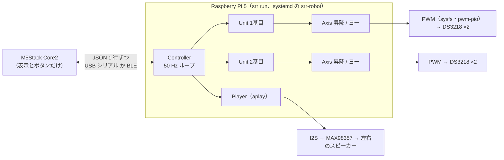
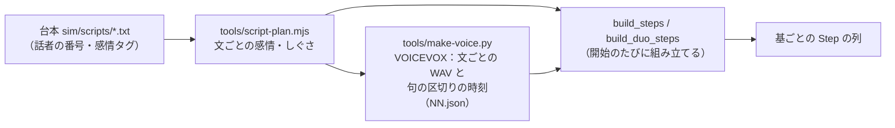

# 制御の手法

実機（`robot/srr/`）が、2 基のロボットをどう動かしているかのまとめ。数値は `robot/config.yaml` と各モジュールの定数（2026-10-28 時点）。動きを決めた根拠は `docs/research/explain-motion.md`（頭部動作の研究）と `docs/research/srr-video-analysis.md`（本家の動画）。

## 全体の構成

- **制御ループ**：`controller.run` が 50 Hz（20 ms）で回る。遅れたら取り戻そうとせず、そこから数え直す。
- **1 周期の処理**：リモコンのイベントを読む → 原点移動の順番待ち → 自動動作の予定 → 各基の `Unit.tick` → 再生の進み → リモコンへ画面を送る。
- **待ちを作る処理は別スレッド**：BLE（asyncio）、USB シリアル、aplay へ流し込む処理。制御ループは止めない。

## 1 軸の制御（`axis.py`・`servo.py`）

### 論理角

各軸は論理角で動かす。サーボ角への換算は軸ごとに決まっている。

| 軸 | 論理角 | サーボ角への換算 | 可動範囲（論理角） |
| --- | --- | --- | --- |
| 昇降 | ホーン角。0° が最下、−61.5° が最上 | そのまま | −60.5° 〜 −1.0°（両端に 1° の余裕。原点は −1.0°） |
| ヨー | テーブル角。0° が正面、＋はお客さんから見て右 | × −1.5（ギア 48:32、逆回転） | ±90° |

### 台形速度の追従

目標までの残り `err` から、止まれる速さ `√(2·amax·|err|)` と最高速度 `vmax` の小さいほうを目標速度にする。そこへ毎周期 `amax·dt` ずつ速度を寄せる。目標を越えたら、そこで止める。

- 加減速つきなので、急に動き出したり止まったりしない。
- 動きにかかる時間は、同じ規則で 1 周期ずつ進めて数える（`explain.travel`）。説明の動きを前もって始めるのに使う。

### 速度と加速度の上限

| 軸 | 最高速度 | 加速度 | 根拠 |
| --- | --- | --- | --- |
| 昇降 | 61.5°/s（1 ストローク 1.0 s） | 400°/s² | 要件「1 ストローク 1 s 以上」 |
| ヨー | 60°/s（テーブル角） | 360°/s² | 要件「テーブル 60°/s 以下」 |

- 要件の上限を超える値は、設定を読む時点でエラーにする（`config.py`）。
- リモコンの「速さ」は加速度だけにかける（100% = `tempo_base` 1.5 倍）。最高速度は要件の上限より上げない（`tempo_cfg`・`scale_speeds`）。

### 角度からパルス幅へ

DS3218（270° 版、50 Hz）を使う。

- **換算**：サーボ角 −135° / 0° / +135° を、パルス幅の min / center / max に合わせる。中心の左右で、別々に直線で補う。
- **向きの反転**：`invert` で符号を反転する。
- **パルス幅の安全範囲**：400〜2600 µs の外は設定エラーにする。
- **角度調整**（リモコンの「角度調整」タブ）：1 基 5 点（昇降の下・上、ヨーの正面・+90°・−90°）で合わせる。結果は `calibration.yaml` に保存し、`config.yaml` の値より優先する。

### PWM の出し方

- **ハード PWM**：GPIO 12・13 は Pi 5（RP1）のハード PWM（`1f00098000.pwm`）を使う。
- **pwm-pio**：ほかの GPIO（16・23）は pwm-pio を使う。チップは番号ではなく名前（`pwm_pio@10` など）で探す。番号は起動の順で変わるため。
- **PCA9685**：`pwm.backend` を切り替えれば使える。`Servo` から上は変えずに済む。

## 安全のしくみ

| しくみ | 中身 | 場所 |
| --- | --- | --- |
| 昇降とヨーのインターロック | 同じ基の昇降とヨーは同時に動かさない。手順で重ねようとしたら `InterlockError` にする | `unit._enter`、手動モード、角度調整 |
| 正面での昇降（通常のサイクル） | 上昇してから旋回し、正面へ戻してから下降する。台本の説明では、ヨーが止まっていれば横を向いたまま昇降してよい | `unit.start_cycle`、`explain` |
| 範囲の制限 | 目標は軸ごとの可動範囲に切り詰める。手動モードも同じ範囲の中だけ | `AxisLimits.clamp` |
| 起動時の原点移動 | 前回の終了姿勢（`pose.json`）から、通常の 30% の速さで原点へ戻す。突入電流を避けるため、1 基ずつ 1 s 空けて始める | `Controller._homing` |
| 停止と終了 | 停止：今の動きをやめ、正面・最下へ戻ってから待機に戻る。昇降の途中なら、下りてから正面へ戻す。終了（SIGTERM）：原点へ戻してから PWM を止める。20 s で戻りきらなければ、そのまま止める | `Unit.abort`、`Controller.request_stop` |
| 重量の見張り | 持ち上げ・急な重さの変化で止める（今は `hx711.enabled: false` で使っていない） | `Unit._watch_weight` |

## 1 基の状態と手順（`unit.py`）

- **状態**：原点移動 → 待機 ⇄ 動作中、のほかに、商品なしと停止がある。
- **手順**：動きは Step の列で表し、1 つずつ実行する。

| Step | 中身 |
| --- | --- |
| `lift` / `yaw` | 1 軸を目標へ動かし、着いたら次へ |
| `wait` | 決めた秒数だけ待つ |
| `speak` | 短い推薦の声を流し、終わるまで待つ（通常のサイクル） |
| `talk` | 1 文分。声を流しながら、声の時刻に合わせた動き（cues）を出す |
| `sync` | 2 基の待ち合わせ（Barrier）。全員が着くまで待つ |

`talk` は次の 4 段で進む。

1. **start**：もう一方の基の声と、前の動きが終わるのを待つ。
2. **speak**：声の始まりからの時刻で、cues を 1 つずつ出す。前の動きが終わるまで、次は出さない。
3. **settle**：声が終わったら、残りの cues は捨てる。今の動きを終えるまで待つ。
4. **return**：その文の高さ（`end_lift`）へ戻る。

テンポを上げるため、話す前のポーズの変更（`pre`）は先に動かし始めて、`pre_lead`（最大 0.5 s）後には動いている途中でも声を出す。

## 説明の動きの組み立て（`explain.py`）

### 台本から手順へ

- **感情**：快さ（valence）と覚醒度（arousal）で表す。シミュレータと同じ規則で、文から推定する（タグで指定もできる）。
- **句の区切り**：VOICEVOX の `audio_query` のアクセント句と息継ぎから出す。うなずきを入れる時刻に使う。
- **組み立てのとき**：その時点の「動きの大きさ」（amp）と「速さ」（tempo）を入れる。

### 文ごとのポーズ

- **向きと高さを決める**：文の頭で向きと高さを変え、話している間はそこに止まる。左右に揺れ続けない。
  - 高さ：行程の 10〜75% に収める。快いほど高い。
  - 向き：正面を中心に ±15°×amp を順に変える。お願い・お礼・呼びかけの文は正対する。不快・照れの文は外側へ 25°×amp そっぽを向く。
- **変えなくてよい動きは省く**：高さの違いが行程の 5% 未満なら昇降しない。

### 1 文の中の動き（`talk_cues`）

| 動き | いつ | 大きさ（行程の割合、× amp） |
| --- | --- | --- |
| 発話のサイン | 声の始まりに少し上がる（1.6 s 未満の短い文では省く） | 0.15 |
| 文末のうなずき | 最後の句の終わりに底が来るよう前もって始める（必ず入れる） | 0.25 ×（覚醒度で 0.9〜1.4） |
| 読点 | 息継ぎのある句の終わりで、うなずき（0.15）と向き変え（15°）を交互に | 0.15 / 15° |
| 首傾げの代わり | 4.5 s 以上の文で、ほかに向き変えがなければ、真ん中に近い弱い区切りで 1 回 | 15° |
| 見せる | 形・回す・ボルトなど見た目の文で、右・左と 35° 回して横を見せる | 35° |
| しぐさ | お礼は深いお辞儀（0.55）、喜びは弾む（0.3）、驚きは高く（0.75）。呼びかけは最初の 1 回だけ、振り向いて正対し 2 回跳ねる（0.4） | |

動きの並べ方（`Timeline`）は次のとおり。

- 動きは「休みの姿勢から出て、狙う時刻に着いたら戻る」形で表す。
- 文末のうなずきやお辞儀のように必ず入れる動きを先に置く。
- 省いてよい動き（読点・見せる・首傾げ）は、空いた時間に収まるときだけ置く。
- かかる時間は `travel` で見積もり、狙う時刻から逆算して始める。

### ダンス（`dance_cues`）

- **いつ**：台本の最初の喜びの文の後に、120 BPM・4 小節の音楽に合わせて踊る。
- **振り付け**：「横へ 30°×amp 振る → 沈む → 跳ねる」を、左右交互に繰り返す。どの動きも、間に合ういちばん近い拍に着くように並べる。
- **終わり方**：最後は正面へ戻り、決めの拍で高い位置（行程の 95%）に着く。
- **音楽**：`tools/make-dance-music.py` で作る。saku の台本では踊らない。

## 2 基の協調（`build_duo_steps`）

| 手法 | 中身 |
| --- | --- |
| 待ち合わせ | 文ごとに Barrier（sync）を置き、2 基がそろってから次の文へ進む。片方の動きが遅れても、ずれがたまらない |
| 声の受け渡し | 声は 1 本ずつ流す。話す基は、もう一方の声が終わるまで待つ |
| 聞き役 | 話していない基は、相手の方へ 20°×amp 向いて聞く。相手の文末で小さくうなずく（0.12×amp）。声は流さず、相手が流し始めた声の時刻に合わせて動く |
| 位置関係 | `partner_side`：ヨーの＋と−のどちらが相手の方か。今は 1 基目が右（−1）、2 基目が左（＋1） |
| そろって話す文 | 2 基とも正面で話す。声は 1 本のステレオ WAV（左＝話者 1、右＝話者 2）で、話者 1 の基のスピーカーが右なら左右を入れ替えて流す |
| キャラの入替 | リモコンの「入替」で、台本の話者 1 と 2 を受け持つ基を入れ替える（`cast`） |
| ダンス | 真ん中を挟んで左右対称に踊る（`mirror`）。振り始めは相手の方へ。音楽は 1 基目が流す |
| 台本の切り替え | `sequence.programs` から選ぶ（今はネジチョコ 掛け合い・saku）。選んだ台本は `settings.json` に残る |

## 声（`audio.py`）

- **再生**：WAV を読み、基ごとのスピーカー（左・右）へ振り分けて、aplay で I2S アンプへ流す。今は 1 基目が右、2 基目が左。
- **音量**：0〜200% で、100% が声のファイルのまま。
- **100% より上の音量**：ピークリミッターで割れないように抑える。
  - 128 サンプルごとのピークから下げる量を決め、前後の区切りも見て早めに下げる。
  - 下げた後は 0.15 s かけて戻す。
  - Python のループを使わずに計算するので、1 文あたり約 30 ms で済む。
  - 200% で、声は約 +6 dB 大きくなる。

## 動きと声のずれ

`srr sync-check 1` で、実機の 1 基で台本を流して測る。

- **声の時刻**：ALSA の記録（`trigger_time`・`hw_ptr`）から取る。
- **動きの時刻**：同じ時計（`time.monotonic`）で比べる。

2026-10-22 の測定（ネジチョコ 16 文、うなずきなどの着地 33 回）の結果は次のとおり。

| 項目 | 結果 |
| --- | --- |
| 声が出るまでの遅れ | 中央値 5.4 ms、最大 9.7 ms |
| 動きの時計と声の位置のずれ | 最大 9.3 ms |
| 着地と狙った句の終わりの差 | 中央値 −14 ms（少し早い）、最大 28 ms |

この測定は、動きの大きさ・速さの基準（`motion_base` 2.0、`tempo_base` 1.5）を決める前のものです。

## リモコン（`remote.py`・`controller.py`・`m5remote/`）

- **役割**：M5Stack は表示とボタンだけを受け持つ。今の状態と、何を調整しているかは Pi が決めて画面の中身を送る。
- **つなぎ方**：USB シリアル（115200 bps、今はこちら）と BLE を、`remote.transport` で選ぶ。
- **送り方**：変わったら最短 0.2 s で送る。変わらなくても 2 s ごとに送り直す。
- **BLE が切れやすい場合**：Pi 5 は Wi-Fi と Bluetooth でアンテナを共有する。2.4 GHz の Wi-Fi が混んでいると、BLE はつないだ直後に切れる（0x3e）。Wi-Fi を 5 GHz にすると安定した。

リモコンで変える値は `~/.local/state/srr-robot/settings.json` に残る。

| 値 | 範囲 | 100% の意味・中身 |
| --- | --- | --- |
| 音量 | 0〜200% | 100% は声のファイルのまま |
| 動きの大きさ | 30〜150% | 100% = `motion_base` 2.0 倍（うなずきの深さ・向きの幅・高さの差にかかる） |
| 速さ | 50〜130% | 100% = `tempo_base` 1.5 倍（加速度にかかる。最高速度は要件の上限まで） |
| 間隔 | 0〜600 s | 開始で動かすとき、台本が終わってから次を始めるまで |
| 台本・入替 | | 流す台本と、キャラの配置 |

ほかのモードは次の 2 つ。どちらも、入るときと出るときに全基を原点へ戻す。

- **角度調整**：5 点でパルス幅を合わせる。
- **手動**：1 軸ずつ、可動範囲の中で動かす。

## 主な定数

| 定数 | 値 | 意味 |
| --- | --- | --- |
| `TICK_HZ` | 50 | 制御ループの周期 |
| `GAP_S` | 0.1 s | 文と文の間 |
| `PRE_LEAD_MAX` | 0.5 s | ポーズを変え始めてから話し出すまで |
| `SIGN_RAISE` / `NOD_END` / `NOD_MID` | 0.15 / 0.25 / 0.15 | 発話のサイン・文末・読点の動き（行程の割合） |
| `BOW` / `HOP_JOY` / `HOP_BECKON` | 0.55 / 0.3 / 0.4 | お辞儀・喜び・呼びかけ |
| `POSE_STEP_DEG` / `LOOK_DEG` / `AWAY_DEG` | 15° / 20° / 25° | ポーズの幅・聞き役が相手を見る角度・そっぽ |
| `GLANCE_DEG` / `SHOW_DEG` | 15° / 35° | 読点の向き変え・見せるときの振れ幅 |
| `DANCE_BPM` / `DANCE_BARS` / `DANCE_SWING_DEG` | 120 / 4 / 30° | ダンス |

角度の定数には amp（動きの大きさ）がかかる。

## 未確認・課題

- **聞き役の動き**：聞き役は最下にいると、うなずく余地がなく、ほとんど止まって見える。saku は最初の約 70 秒が 1 人ずつの推薦なので目立つ。
- **ずれの測り直し**：動きの大きさ・速さの基準を変えた後に、`sync-check` で測り直していない。2 基で流すときの測定もない。
- **重量センサー**：HX711 の読みが 0 のままなので、使っていない。
- **BLE**：会場の Wi-Fi が 2.4 GHz だと切れやすい。USB シリアルを予備にする。
